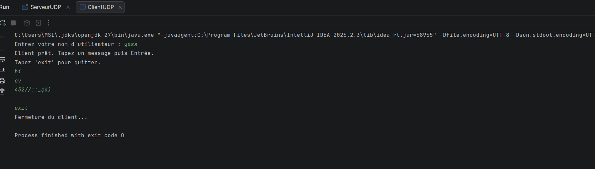
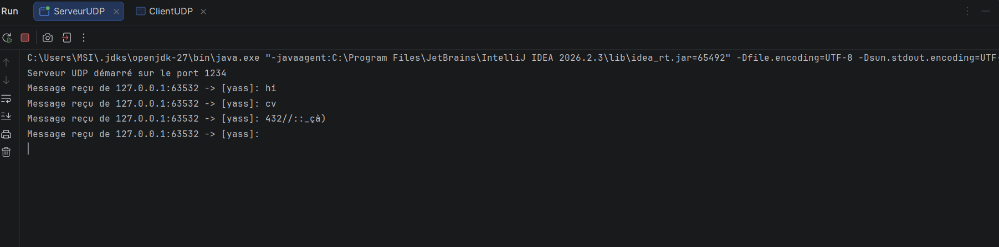
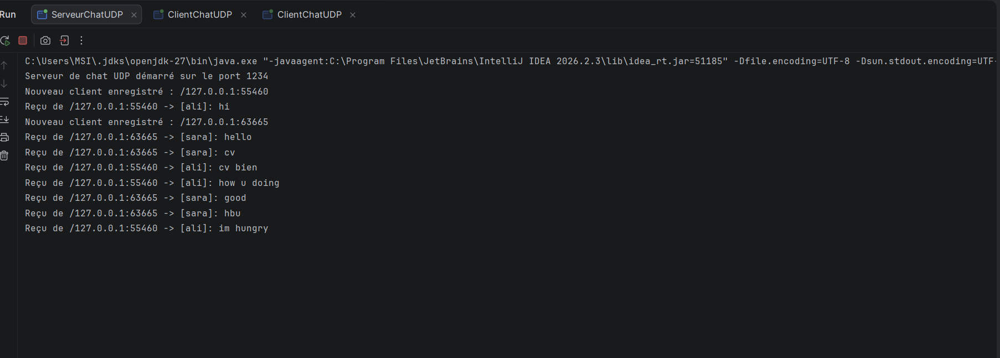
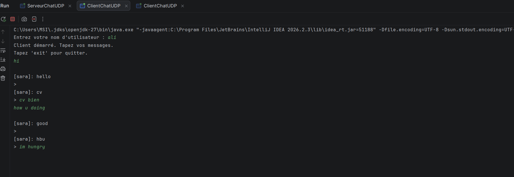
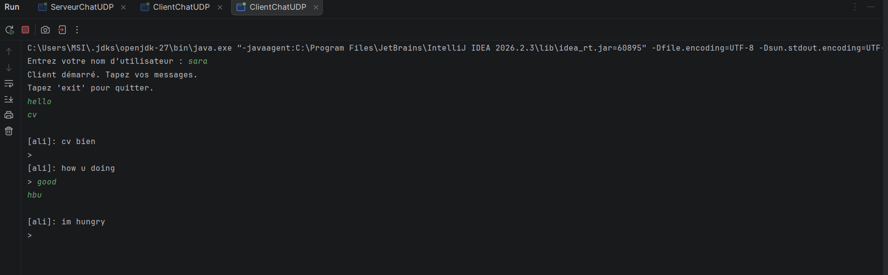

# TP4 : Sockets en mode non connecté UDP

##  Informations générales

- **Étudiant :** Ben Maalem Yassine
- **Classe :** LSI 3
- **Matière :** Développement d’applications réparties
- **Responsable du cours :** Amal ABID
- **Enseignante des TPs :** Zeineb DAOUD
- **Année universitaire :** 2026-2027

##  Objectifs

- Maîtriser l’échange de données sous forme de datagrammes avec `DatagramPacket`.
- Utiliser les sockets UDP avec la classe `DatagramSocket` en Java.
- Comprendre la communication en mode non connecté entre un client et un serveur.
- Implémenter une application de chat client-serveur avec le protocole UDP.
- Gérer l’envoi et la réception asynchrones des messages.
- Permettre la communication entre plusieurs clients grâce au multithreading.

---

##  Étape 2 : Chat unidirectionnel avec un seul client

Dans cette étape, le client envoie des messages au serveur. Le serveur reçoit les datagrammes et affiche chaque message avec l’adresse IP et le port de l’expéditeur.

### 1. Côté client : `ClientUDP`

Le client demande un nom d’utilisateur et envoie les messages au serveur sous forme de datagrammes.



### Logs du client

```text
Entrez votre nom d'utilisateur : yass
Client prêt. Tapez un message puis Entrée.
Tapez 'exit' pour quitter.
hi
cv
432//::_çà)
exit
Fermeture du client...
```

### 2. Côté serveur : `ServeurUDP`

Le serveur écoute les messages UDP reçus sur le port `1234` et affiche l’adresse IP, le port et le contenu de chaque message.



### Logs du serveur

```text
Serveur UDP démarré sur le port 1234
Message reçu de 127.0.0.1:63532 -> [yass]: hi
Message reçu de 127.0.0.1:63532 -> [yass]: cv
Message reçu de 127.0.0.1:63532 -> [yass]: 432//::_çà)
```

---

##  Étape 3 : Chat bidirectionnel avec plusieurs clients

Dans cette étape, plusieurs clients peuvent communiquer simultanément.

Le serveur conserve les adresses des clients actifs dans une liste de type `SocketAddress`. Lorsqu’un client envoie un message, le serveur le diffuse à tous les autres clients, à l’exception de l’expéditeur.

Le client utilise deux threads :

- un thread pour envoyer les messages ;
- un thread pour recevoir les messages.

### 1. Côté serveur : `ServeurChatUDP`

Le serveur enregistre automatiquement un client dès la réception de son premier message. Il diffuse ensuite les messages reçus à tous les autres clients enregistrés.



### Logs du serveur

```text
Serveur de chat UDP démarré sur le port 1234
Nouveau client enregistré : /127.0.0.1:55460
Reçu de /127.0.0.1:55460 -> [ali]: hi
Nouveau client enregistré : /127.0.0.1:63665
Reçu de /127.0.0.1:63665 -> [sara]: hello
Reçu de /127.0.0.1:63665 -> [sara]: cv
Reçu de /127.0.0.1:55460 -> [ali]: cv bien
Reçu de /127.0.0.1:55460 -> [ali]: how u doing
Reçu de /127.0.0.1:63665 -> [sara]: good
Reçu de /127.0.0.1:63665 -> [sara]: hbu
Reçu de /127.0.0.1:55460 -> [ali]: im hungry
```

### 2. Côté client 1 : Ali

Le client Ali envoie des messages et reçoit les messages de Sara en temps réel.



### Logs du client Ali

```text
Entrez votre nom d'utilisateur : ali
Client démarré. Tapez vos messages.
Tapez 'exit' pour quitter.
hi

[sara]: hello
> cv bien
how u doing

[sara]: good
>
[sara]: hbu
im hungry
```

### 3. Côté client 2 : Sara

Le client Sara reçoit les messages envoyés par Ali et peut lui répondre en temps réel.



### Logs du client Sara

```text
Entrez votre nom d'utilisateur : sara
Client démarré. Tapez vos messages.
Tapez 'exit' pour quitter.
hello
cv

[ali]: cv bien
> good
[ali]: how u doing
> hbu
[ali]: im hungry
```

---

##  Synthèse

Ce TP m’a permis de comprendre le fonctionnement du protocole **UDP**, ou **User Datagram Protocol**, ainsi que sa différence avec le protocole TCP.

Contrairement à TCP, UDP est un protocole non connecté. Aucune connexion persistante n’est établie entre le client et le serveur. Chaque message est envoyé indépendamment sous la forme d’un datagramme contenant l’adresse du destinataire.

### Compétences acquises

- Utilisation de `DatagramSocket` pour créer un socket UDP.
- Utilisation de `DatagramPacket` pour envoyer etdans une même application.
- Conservation des adresses des clients dans une `CopyOnWriteArrayList`.
- Diffusion des messages à tous les clients connectés.
- Exclusion de l’expéditeur pendant la diffusion.
- Utilisation du multithreading pour séparer l’envoi et la réception.
- Mise en place d’une communication asynchrone en temps réel.


---

##  Conclusion

Ce TP a permis de mettre en pratique la programmation réseau en Java avec les sockets UDP.

La première partie a permis de réaliser une communication unidirectionnelle entre un client et un serveur.

La deuxième partie a permis de développer un chat bidirectionnel et multiclient grâce au multithreading et à la diffusion des messages.

Cette application montre que le protocole UDP permet de créer une communication rapide et simple entre plusieurs machines.